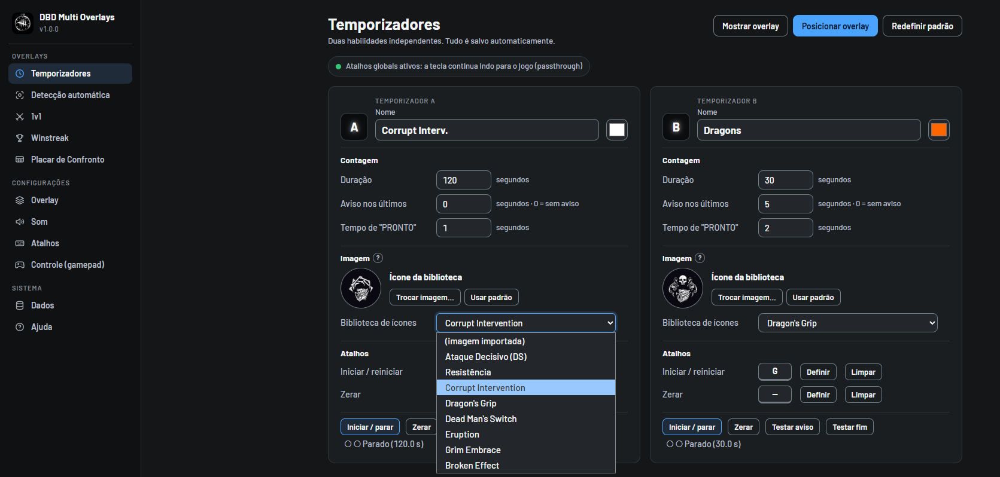

# DBD Multi Overlays

**Ferramentas, temporizadores e overlays para Dead by Daylight.**

Um aplicativo para Windows que reúne ferramentas de acompanhamento, personalização e overlays para suas partidas e transmissões.

  <a href="#recursos">Recursos</a> ·
  <a href="#galeria">Galeria</a> ·
  <a href="#documentação">Documentação</a> ·
  <a href="#requisitos">Requisitos</a> ·
  <a href="#suporte">Suporte</a>

---

## Sobre o aplicativo

O **DBD Multi Overlays** é um aplicativo para Windows desenvolvido para jogadores de Dead by Daylight que desejam personalizar sua experiência e apresentar informações durante transmissões.

O aplicativo reúne temporizadores, detecção automática, Winstreak, overlays de Killer, placares e ferramentas de personalização, com integração ao OBS Studio.

## Recursos

### Temporizadores

Crie temporizadores personalizados e ajuste duração, cores, ícones e sons. Os overlays podem ser posicionados individualmente.

### Detecção automática

A detecção automática identifica a posição dos ganchos dos sobreviventes no HUD e auxilia no acompanhamento dos estados de Ataque Decisivo (DS) e Resistência (Endurance), com suporte aos slots J1–J4.

### Winstreak

Acompanhe sequências de vitórias, registre resultados e visualize recordes por Killer. Personalize a apresentação do overlay, incluindo título, imagem, cores e o campo opcional **Tipo de Streak**.

### Killer Overlay e Overlay Unificado

Apresente informações dos elementos A/B em overlays próprios ou em uma janela unificada, com opções de posicionamento e personalização.

### Placar de Confronto e 1v1

Utilize os placares para acompanhar confrontos e partidas 1v1, com elementos visuais próprios e opções de personalização.

### Personalização e controles

Ajuste posição, escala, opacidade e aparência dos elementos. O editor permite movimentar componentes individualmente. O aplicativo também oferece controles por teclado, mouse e gamepad, conforme os atalhos configurados.

---

## Galeria

Confira algumas capturas reais das funcionalidades do aplicativo.

<table>
  <tr>
    <td width="50%" valign="top">
      <h3 align="center">Temporizadores</h3>
      
      
Configuração e personalização dos temporizadores.

    </td>
    <td width="50%" valign="top">
      <h3 align="center">Painel da Winstreak</h3>
      
      
Configuração e acompanhamento das sequências de vitórias.

    </td>
  </tr>
  <tr>
    <td width="50%" valign="top">
      <h3 align="center">Overlay de Winstreak</h3>
      
      
Apresentação da Winstreak durante a transmissão.

    </td>
    <td width="50%" valign="top">
      <h3 align="center">Placar de Confronto</h3>
      
      
Visualização do placar durante o confronto.

    </td>
  </tr>
  <tr>
    <td colspan="2" valign="top">
      <h3 align="center">Placar 1v1</h3>
      

        
      

      
Placar dedicado ao acompanhamento de partidas 1v1.

    </td>
  </tr>
</table>

---

## Documentação

Os guias estão disponíveis diretamente neste repositório:

| Guia | Conteúdo |
|---|---|
| [Instalação](./installation.md) | Instalação, ativação, atualização e remoção |
| [Primeiros passos](./getting-started.md) | Visão geral do painel e configuração inicial |
| [Winstreak](./winstreak.md) | Registro de resultados e personalização do overlay |
| [Killer Overlay](./killer-overlay.md) | Overlays, detecção automática, placares e 1v1 |
| [Solução de problemas](./troubleshooting.md) | Problemas comuns e possíveis soluções |
| [Perguntas frequentes](./faq.md) | Respostas às dúvidas mais comuns |

## Requisitos

- Windows 10 ou Windows 11, 64 bits.
- Dead by Daylight configurado em modo janela sem bordas para os recursos que dependem da captura do HUD.
- (opcional) OBS Studio para utilizar os overlays em transmissões.
- (opcional) Controle compatível com XInput para os recursos de gamepad.

Consulte o [guia de instalação](./installation.md) para instruções e observações adicionais.

## Suporte

Para dúvidas, orientações de instalação ou suporte, entre em contato pelo Discord: **MarliNNNBr**

Ou em meu servidor: **https://discord.gg/mx2bAQpRpD**

Antes de solicitar suporte, consulte a [solução de problemas](./troubleshooting.md) e as [perguntas frequentes](./faq.md).

## Aviso

DBD Multi Overlays é um projeto independente e não é afiliado, patrocinado ou endossado pela Behaviour Interactive.

Dead by Daylight e seus elementos visuais pertencem aos respectivos titulares. Os retratos de personagens utilizados no aplicativo são creditados à Behaviour Interactive.

O aplicativo não realiza leitura de memória do jogo nem injeção de código.

---

**DBD Multi Overlays** · Ferramentas e overlays para Dead by Daylight.

